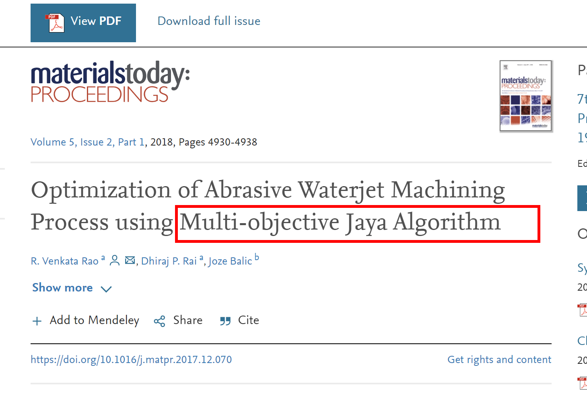
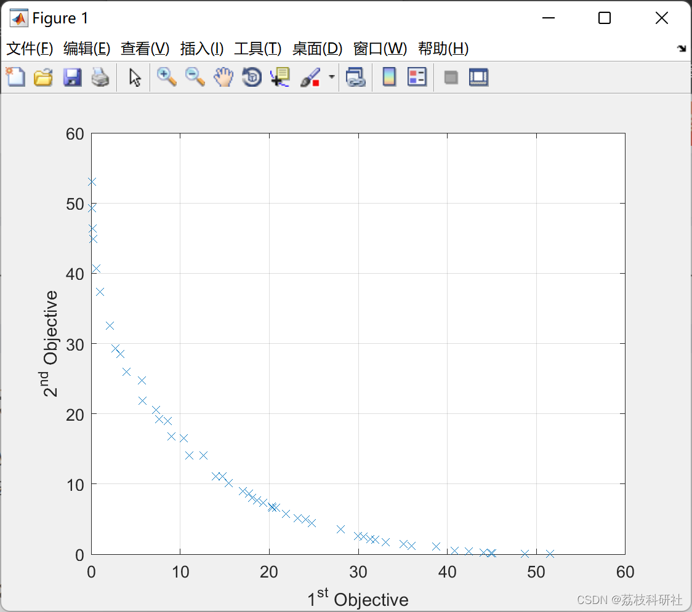

# Multi-objective Jaya Optimization Algorithm (Matlab Code Implementation)

Article Explanation:
Article download link: Optimization of Abrasive Waterjet Machining Process using Multi-objective Jaya Algorithm - ScienceDirect
\n        \n  
\n        \n  

## Images

<!-- PAYMENT_BLOCK -->

## Get this dataset

- Payment link (Stripe): [Buy now](https://buy.stripe.com/3cs8yP7sY87d0vu9AB)
- Payment QR code: 

<!-- /PAYMENT_BLOCK -->
